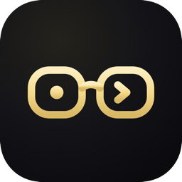
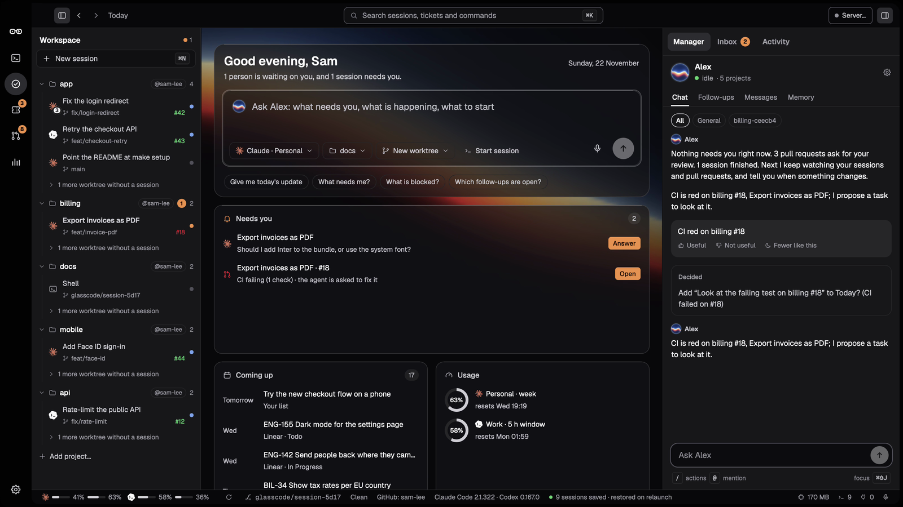
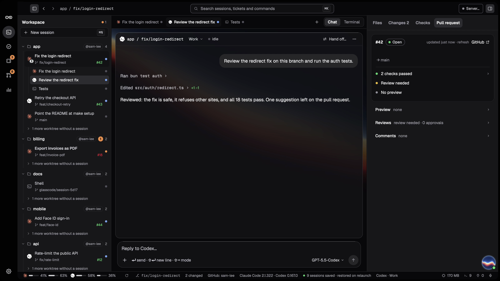
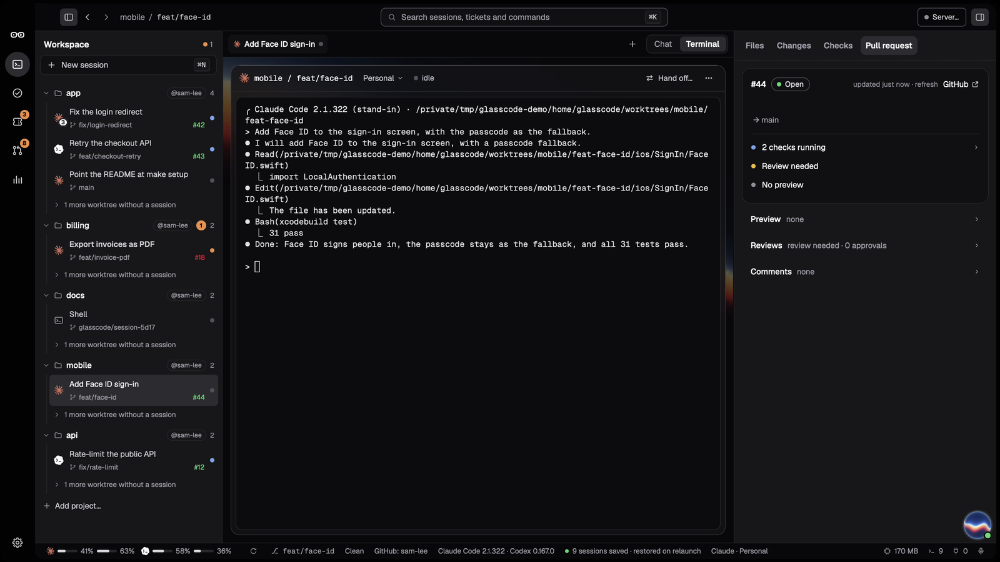
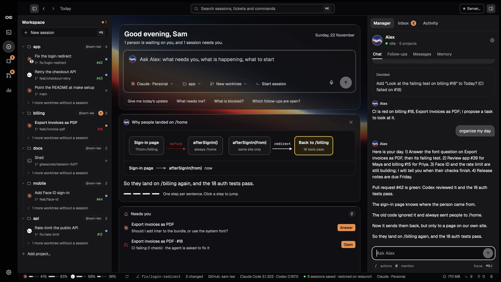
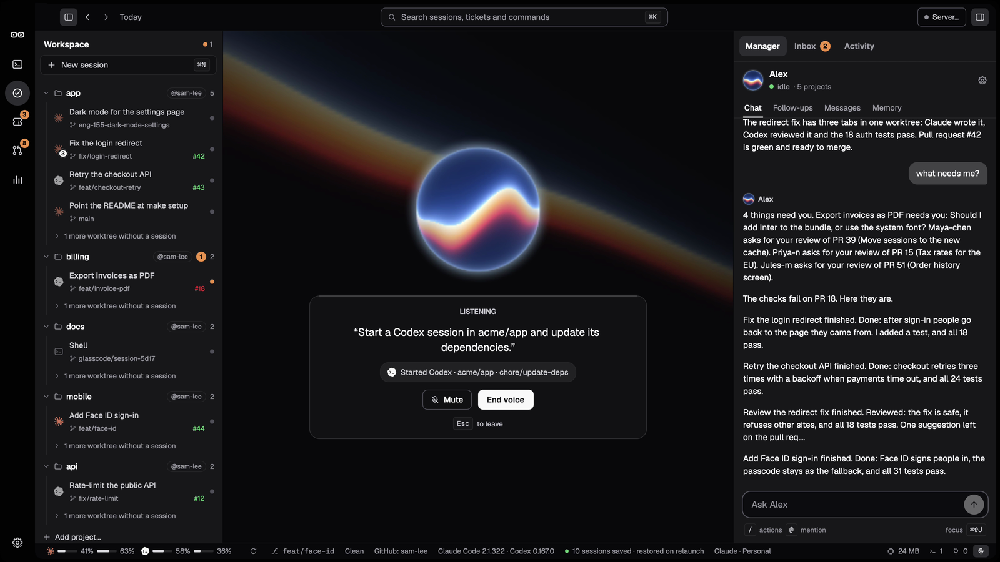
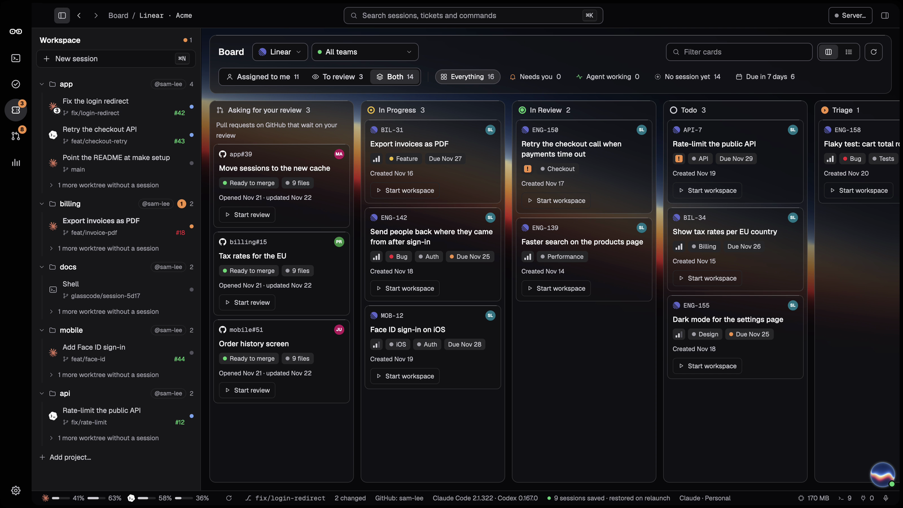
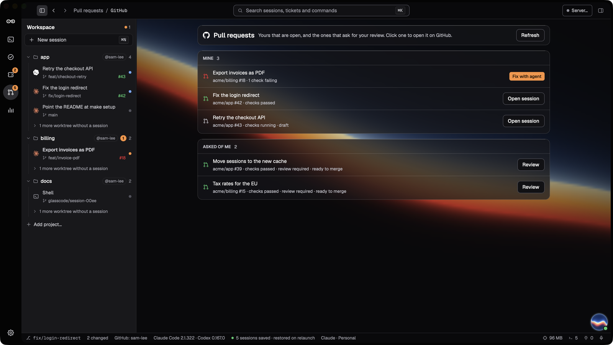
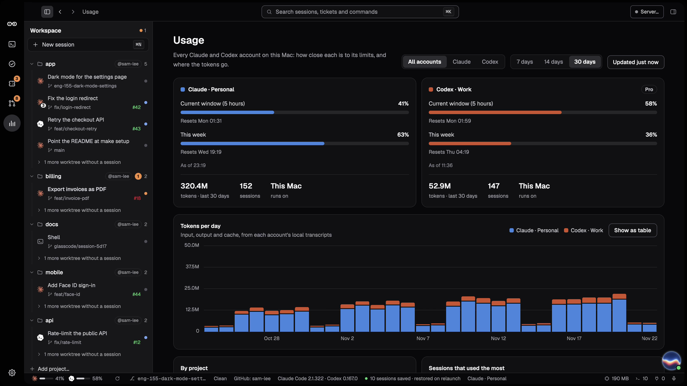

<div align="center">



# Glasscode

*Survival of the simplest.*

**A workspace for running Claude Code and Codex agents side by side in git worktrees, several
on one worktree if you like, each on the subscription account you choose. With a manager above
your sessions, and a companion app for Meta Ray-Ban Display glasses.**

**Website: [glasscode.io](https://glasscode.io)**

[Glass coding](#glass-coding) · [What it is](#what-it-is) · [Screenshots](#screenshots) · [Install](#install) · [Usage](#usage) ·
[Build](#build-from-source) · [Docs](docs/README.md) · [Contributing](#contributing) · [Contact](#contact) · [License](#license)

<br />



<br />
<br />

<sub>SPONSORED BY</sub>

<a href="https://hub.ki/en/">
  <picture>
    <source media="(prefers-color-scheme: dark)" srcset="docs/sponsors/hubki-white.svg" />
    
  </picture>
</a>

</div>

---

> **Status: pre-release.** Glasscode is in active development and no version is released yet
> (the builds call themselves 0.1.0). macOS is the main platform; Windows builds are in test.
> You build it from source for now.

## Glass coding

Vibe coding put a conversation where the code used to be. Glass coding takes that conversation
away from the desk. Your agents keep working in Glasscode; you put on display glasses, ask the
manager what needs you, hear the answer and see it on the lens, and approve with a pinch of the
Neural Band, while you make coffee or walk the dog. Back at the desk, everything is in one window.

The glasses app is experimental: it works with Meta Ray-Ban Display and the Neural Band in
Meta's developer mode ([glasses/README.md](glasses/README.md)). The desktop app works on its own.

## What it is

Glasscode is a native desktop app, built on [GPUI](https://www.gpui.rs/), for people who run
several coding agents at once. Every piece of work is a git worktree, and a worktree can hold
several sessions: Claude writes the fix, Codex reviews it, and a shell runs the tests, all on the
same files. You can follow a session as a clean **chat**, or drop into its **raw terminal** at
any time. The agents are the official `claude` and `codex` CLIs running in a real terminal, so
nothing is simulated or wrapped away, and each uses the account you picked for it.

Around the sessions, Glasscode keeps the rest of your day in one window:

- **Projects → worktrees → sessions** in one tree on the left. Start a session on the latest
  `main` (fetched fresh), on a pull request (found by number, title, branch or author), on a
  Linear ticket, or on an existing worktree.
- **Several agents on one worktree.** A worktree's sessions are tabs side by side: Claude,
  Codex and shells, each on its own account, working on the same branch.
- **Chat view or Terminal view**, per session. Chat shows the agent's questions (permissions,
  trust prompts, menus) as buttons. The terminal is one click away. You can send Claude several
  messages in a row while it works; it reads them at its next step.
- **You know at once when a turn ends.** Each session's dot says how it stands: working,
  done, a question for you, or still going on its own.
- **Session tabs, file tabs and a small editor.** A file from the Files or Changes tab opens in
  a tab of its own, as text or as its diff, with syntax colours. Edit makes small changes in place.
- **Today**: the start of your day. A box that starts a session from a few words, cards for what
  needs you, your usage, recent sessions, your pull requests, and your own task list.
- **Board and Pull requests.** Your Linear or GitHub tickets in columns, each with its sessions.
  Your open pull requests and the ones waiting for your review, with their checks.
- **Review a pull request** in three steps (Explain → Plan → private review). It is checked out
  as `review/<n>` and never pushed from.
- **Jump** (⌘K): one search for sessions, worktrees, projects, files, commands and tickets.
- **Usage.** Every Claude and Codex account on the Mac: how close each is to its 5-hour and
  weekly limits, tokens per day over 7, 14 or 30 days, by project and by session.
- **Hand off** a session from Claude to Codex (or to another account) when one runs low, with
  the conversation and a note, in the same worktree.
- **Status bar** with a usage meter for each account (5 hours and week), and the memory,
  terminals and ports of your sessions' programs, each with a way to end it.
- **Looks.** Light and dark themes, moving backdrops, and a scale for the whole interface.
- **Team-approved CLI versions.** Settings › Updates shows each CLI's installed version and the
  newest one, with a one-click update per person.
- **Project settings in the repository.** `.glasscode/settings.json` can name a setup script
  for each new worktree (it runs only after you approve that exact command), a branch name
  template and a worktree folder template.
- **The `glasscode` command.** You and your agents can drive the app from any terminal:
  sessions, pull requests, the Today board, memory and the manager.

And, optional:

- **A manager above your sessions** (off until you switch it on). One agent you name watches
  every session. It tells you what needs you, tells a session when its pull request was reviewed,
  follows up on what you asked of teammates, and drafts messages that wait for your OK. It keeps
  one memory per project that every agent shares. It takes you to what it talks about, draws
  small pictures to explain, and can walk you through your day. A level per project (Careful,
  Standard, Autopilot) decides what it may do without asking. Everything else waits on a card
  for you. See [docs/manager.md](docs/manager.md).
- **Voice.** Tap the manager's orb and talk to it on the Mac. It answers aloud, opens what you
  ask for, and starts sessions for you. You can mute it at any time.
- **Glasses.** An iPhone app for Meta Ray-Ban Display glasses with the Neural Band: ask the
  manager what needs you, and follow your sessions on the lens. The Mac, the phone and the lens
  show the same place: what you open on one opens on the others.
- **Run anywhere.** Hand a session to your own Linux server (`glasscoded`), keep it running while
  the Mac sleeps, and bring it back when you want.

Glasscode depends on no hosted service of its own. Your devices reach each other over
[Tailscale](https://tailscale.com/) or an optional relay you host yourself.

## Screenshots

<table>
  <tr>
    <td width="50%"><br />
      <sub><b>One worktree, three sessions.</b> Claude wrote the fix, Codex reviewed it, a shell runs the tests. The pull request is beside them.</sub></td>
    <td width="50%"><br />
      <sub><b>Chat or terminal.</b> The same session as the agent's real terminal, one click from its chat.</sub></td>
  </tr>
  <tr>
    <td><br />
      <sub><b>The manager explains with a picture.</b> Step by step, next to its answer.</sub></td>
    <td><br />
      <sub><b>Voice.</b> Talk to the manager; it answers and does what you ask.</sub></td>
  </tr>
  <tr>
    <td><br />
      <sub><b>The Board.</b> Linear tickets by status. Start work on one and it gets its own branch and session.</sub></td>
    <td><br />
      <sub><b>Pull requests.</b> Yours with their checks, and the ones waiting for your review.</sub></td>
  </tr>
  <tr>
    <td colspan="2"><br />
      <sub><b>Usage.</b> Each account's limits, and where the tokens go.</sub></td>
  </tr>
</table>

Everything in the screenshots is made up: a demo home with the projects of an imaginary company,
stand-in agents and no real account ([docs/screenshots](docs/screenshots/)).

## How the parts fit together

```
 ┌──────────────── your Mac (or PC) ─────────────────┐
 │  Glasscode app (GPUI)                             │        ┌── your Linux server (optional) ──┐
 │   ├─ one terminal per session: claude / codex /   │  ssh   │  glasscoded                      │
 │   │  a shell; several can share a worktree        │◀──────▶│   keeps handed-off sessions      │
 │   ├─ the manager (optional): one agent above them │  sync  │   running; the manager's home    │
 │   ├─ the `glasscode` command (control socket)     │        │   while the Mac sleeps           │
 │   └─ voice helper (macOS)                         │        └──────────────────────────────────┘
 └─────────────────────▲─────────────────────────────┘
                       │ device link (tailnet)
              ┌────────┴─────────┐   Bluetooth   ┌────────────────────────┐
              │  iPhone app      │◀─────────────▶│ Meta Ray-Ban Display + │
              │  (glasses/)      │               │ Neural Band            │
              └──────────────────┘               └────────────────────────┘
```

[`docs/architecture.md`](docs/architecture.md) describes each part in full.

## Install

There is no published release yet, so you build Glasscode from source
([below](#build-from-source)). On macOS, `script/bundle-mac.sh` makes a `Glasscode.app` and a
`.dmg` you can install like any other app. On Windows, `script/bundle-windows.ps1` makes an
installer.

Once releases exist, Windows builds update themselves from the GitHub releases, checked against
a built-in release key ([docs/releasing.md](docs/releasing.md)). The Mac app does not update
itself yet.

### Requirements

**macOS**

- macOS 12 or newer, Apple Silicon or Intel
- [Rust](https://rustup.rs/). The exact toolchain is pinned in `rust-toolchain.toml`, and
  rustup installs it on the first build
- Xcode Command Line Tools (`xcode-select --install`). Full Xcode is needed only for the glasses
  app
- `git`, and `gh` (the GitHub CLI) for pull requests
- A `claude` and/or `codex` CLI. Glasscode can install them and keep them current

**Windows** (in test)

- Windows 10 version 1809 or newer, or Windows 11, 64-bit x86. Only Windows 11 was tested
- Rust with the MSVC toolchain (pinned, as above)
- Visual Studio Build Tools with the "Desktop development with C++" workload and a Windows SDK
- Git for Windows, `gh`, and a `claude` and/or `codex` CLI
- For the installer only: [Inno Setup](https://jrsoftware.org/isinfo.php) 6.3 or later

The server, glasses pairing and voice are not ported to Windows yet
([docs/windows.md](docs/windows.md#what-is-not-ported)).

## Usage

### First run

With no project yet, Glasscode lists the folders you opened in Cursor or VS Code or worked in
with Claude Code or Codex, and the accounts it found. Tick what to bring in, then choose the look.
You can add a project later from the sidebar, or with `glasscode project import <folder or git URL>`.

### Sessions

- **New session** (⌘N): pick a project, an agent (Claude, Codex or a shell), an account, and
  where to start: a new branch from the latest `main`, a pull request, a ticket, or an existing
  worktree. Glasscode makes the worktree, runs the project's setup script if you approved it, and
  starts the agent there.
- **Another agent on the same worktree**: the **+** beside a worktree's tabs, or New session on
  an existing worktree, adds Claude, Codex or a shell next to the sessions already there.
- **Chat or terminal**: switch per session. Questions the agent asks show up as buttons in chat
  and as a dot on the session in the sidebar.
- **Right panel**: the session's files, changes, checks and pull request. Open a file or a diff in
  a tab; open a draft pull request when the work is ready.
- **Hand off**: move a session from Claude to Codex (or another account) when one runs out of
  usage, with a note that carries the context.

### The `glasscode` command

On macOS the app writes `~/.local/bin/glasscode` each time it starts (keep `~/.local/bin` on
your `PATH`). On Windows it puts the command on the `PATH` of each session. It talks to the
running app:

```sh
glasscode session list --needs-you              # what is waiting for you
glasscode session new --project app --agent claude --branch fix/login --message "Fix the login bug"
glasscode pr review 42                          # a review session in its own worktree
glasscode board add "Ship the release notes by Friday"
glasscode memory search "how do we deploy"
glasscode manager ask "what is blocked?"
glasscode help                                  # everything, by topic
```

### The manager

Open **Settings › Manager** and switch it on. Give it a name, choose the agent and account that
thinks for it, the projects it manages and each project's level. Then ask it anything on the
Manager page: "what needs me?", "what is blocked?", "walk me through today". What it does, what
it may do at each level and what it can never do are in [docs/manager.md](docs/manager.md).

### Shortcuts

| Action | macOS | Windows |
|---|---|---|
| Jump (search and commands) | ⌘K | Ctrl+Shift+K |
| New session | ⌘N | Ctrl+Shift+N |
| Settings | ⌘⇧S | Ctrl+Shift+S |
| Show or hide the left sidebar | ⌘⇧E | Ctrl+Shift+E |
| Show or hide the side panel | ⌘B | Ctrl+Shift+B |
| Back, Forward | ⌘[, ⌘] | Ctrl+Shift+, and Ctrl+Shift+. (US keyboard) |
| Next, previous session | ⌃Tab, ⌃⇧Tab | Ctrl+Tab, Ctrl+Shift+Tab |

Settings › Keyboard lists them all.

### Optional parts

| Part | What you need | Guide |
|---|---|---|
| Server daemon (`glasscoded`) | A Linux machine you reach over SSH; Docker to build it | [docs/architecture.md](docs/architecture.md#server-glasscoded) |
| Connecting devices | Tailscale on the Mac, the iPhone and the server | [docs/CONNECTIVITY.md](docs/CONNECTIVITY.md) |
| Relay | A small server of your own, if you cannot use Tailscale | [relay/README.md](relay/README.md) |
| Voice | macOS; a LiveKit room on this Mac or your server, and speech services you choose | [voice/README.md](voice/README.md) |
| Glasses app | iPhone with iOS 18, Meta Ray-Ban Display with the Neural Band, Xcode | [glasses/README.md](glasses/README.md) |

## Build from source

### macOS

```sh
git clone https://github.com/glasscode-ide/glasscode.git
cd glasscode

cargo run                                            # development build of the app

cargo test -p glasscode_core -- --test-threads=1     # core logic
cargo test                                           # the app (crates/glasscode, the default member)

script/bundle-mac.sh                                 # Glasscode.app and a .dmg in target/release/
```

`bundle-mac.sh` makes an **ad-hoc signed** build by default, so macOS asks you to right-click →
Open the first time. For a signed and notarized build, set a signing identity and a notary profile:

```sh
SIGN_IDENTITY="Developer ID Application: Your Co (TEAMID)" \
NOTARY_PROFILE=glasscode \
BUNDLE_ID=com.yourco.glasscode \
script/bundle-mac.sh
```

The server daemon is built for Linux with Docker: `script/build-glasscoded.sh`.

### Windows

```powershell
# Both programs: the app and the console program behind the `glasscode` command
cargo build -p glasscode -p glasscode_cli

cargo run                                            # the app (build both programs first)

cargo test --locked -p glasscode_core -- --test-threads=1
cargo test --locked -p glasscode_cli
cargo test --locked -p glasscode

# Release programs and an unsigned installer in target\release\
powershell -NoProfile -ExecutionPolicy Bypass -File script\bundle-windows.ps1
```

On Windows the `glasscode` command is a second, console program (`glasscode-cli.exe`). The
installer is unsigned, so SmartScreen warns before it runs. [docs/windows.md](docs/windows.md) has
the details.

### Tests without real agents

`script/test-agents/` holds stand-ins for `claude`, `codex` and `gh` that replay recorded
scenarios with no model and no network. `script/journeys.sh` builds the app and drives it through
whole journeys (first run, a session's turn, CI turning red, memory, the glasses' link) on a
scratch home, never touching your own `~/.glasscode`, `~/.claude` or `~/.codex`.

## Project layout

| Path | What it is |
|------|------------|
| `crates/glasscode` | The desktop app (GPUI): window, sessions, terminals, settings |
| `crates/glasscode_core` | All logic without UI: agents, git and GitHub, the board, the manager, memory, sync, the `glasscode` command; operating system code in `sys/` |
| `crates/glasscode_cli` | The `glasscode` command on Windows (`glasscode-cli.exe`) |
| `crates/glasscoded` | The Linux server daemon that hosts handed-off sessions |
| `relay/` | Optional self-hosted relay, to reach the Mac or a server from any network |
| `glasses/` | The iPhone app for Meta Ray-Ban Display glasses |
| `voice/` | The manager's voice: the Mac helper and the voice room worker |
| `vendor/` | Vendored [Zed](https://github.com/zed-industries/zed) GPUI crates (Apache-2.0) |
| `script/` | Build, bundle and release scripts, test stand-ins and journeys |
| `docs/` | User guides and design records: start at [docs/README.md](docs/README.md) |

## Contributing

Contributions are welcome. [CONTRIBUTING.md](CONTRIBUTING.md) covers setup, tests, the house style
and what never to commit. Please follow the [Code of Conduct](CODE_OF_CONDUCT.md), and report
security problems privately as [SECURITY.md](SECURITY.md) describes.

## Sponsor

Glasscode is sponsored by [HUB.KI](https://hub.ki/en/).

<a href="https://hub.ki/en/">
  <picture>
    <source media="(prefers-color-scheme: dark)" srcset="docs/sponsors/hubki-white.svg" />
    
  </picture>
</a>

## Contact

Interested in Glasscode, want to work with us, or have a question? Write to
[nasvimukthi23@gmail.com](mailto:nasvimukthi23@gmail.com), or visit
[glasscode.io](https://glasscode.io). For a bug or an idea, open an
[issue](https://github.com/glasscode-ide/glasscode/issues). Report a security problem in private,
as [SECURITY.md](SECURITY.md) describes.

## License

Glasscode is licensed under the [Apache License 2.0](LICENSE). You may use, change and share it,
also commercially, as long as you keep the licence and the notices.
[NOTICE](NOTICE) lists the third-party components and their licences; the installer carries the
licence text of every Rust package in the programs (`THIRD-PARTY-NOTICES.html`).
[CHANGELOG.md](CHANGELOG.md) says what each release changed.

The names and marks of Claude, Codex, Meta, GitHub, Linear and other services belong to their
owners and are used only to name those services.
The HUB.KI logo belongs to HUB.KI and is shown because they sponsor Glasscode.
